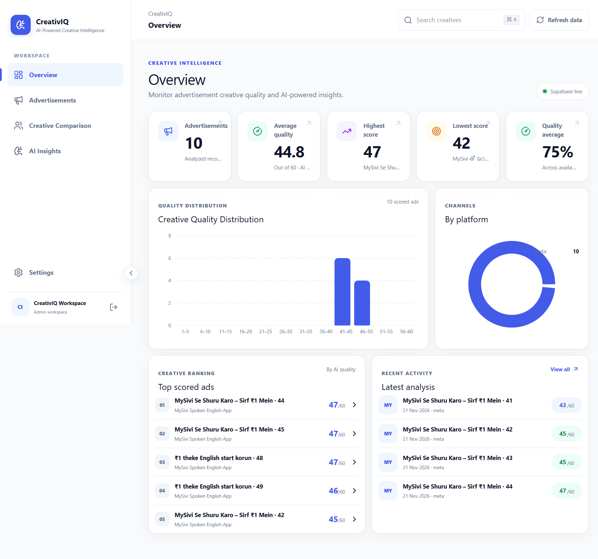
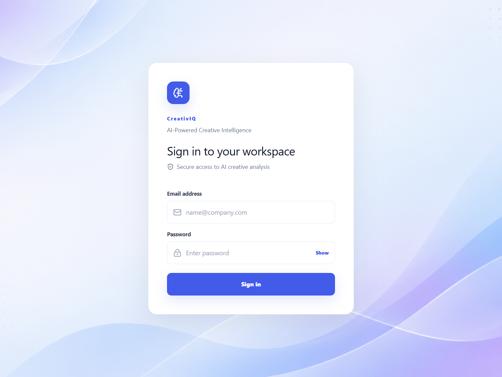
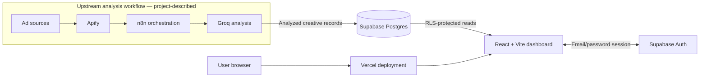

# CreativIQ — AI-Powered Creative Intelligence

CreativIQ is a full-stack creative intelligence dashboard for exploring AI-analyzed advertisements. It turns existing creative assessments into searchable records, quality breakdowns, comparisons, and practical recommendations.

[**Open the live dashboard**](https://creativiq-five.vercel.app) · [GitHub repository](https://github.com/gamepatt78/creativiq)

> **Important:** Creative-quality scores are AI assessments of ad creative. They are not advertising performance metrics and do not represent impressions, reach, clicks, conversions, revenue, or ROAS.

## The problem

Creative reviews can be hard to compare consistently across a growing set of advertisements. CreativIQ gives teams one workspace to search their analyzed creative, inspect the reasoning behind a score, compare two ads across the same categories, and spot recurring themes.

## Key features

- **Workspace overview:** advertisement count, average creative-quality score, score distribution, platform mix, top creatives, and recent analyses.
- **Advertisement explorer:** search by creative details, filter by platform and score band, sort results, paginate, and refresh Supabase data.
- **Creative detail:** review the ad copy, six category scores, strengths, weaknesses, and suggested improvements.
- **Side-by-side comparison:** compare two ads with overall score deltas, a six-dimension radar chart, category differences, and creative direction fields.
- **AI insights:** review highly rated creatives and recurring strengths, weaknesses, and suggestions from existing analyses.
- **Protected workspace:** sign in with Supabase email/password authentication; unauthenticated visitors see the sign-in page.
- **Responsive interface:** navigable workspace shell with route-level loading, empty, and error states.

## AI creative-quality scoring

The dashboard presents analysis already stored in Supabase; the browser app does not run the upstream model. The overall creative-quality score is displayed on a 0–60 scale. The detail view breaks it into six dimensions: Hook, Value Proposition, Message Clarity, CTA, Audience Relevance, and Creative Execution. Strengths, weaknesses, and suggested improvements are shown when present in the record.

These scores help assess creative content. They do not indicate how an advertisement performed in market. The current dataset does not provide delivery or conversion metrics, and the dashboard does not infer or fabricate them.

## Dashboard screenshots

Screenshots below are genuine captures of the deployed CreativIQ interface. The overview uses a sample workspace dataset.

### Overview



### Production sign-in



## Technology stack

| Layer | Technologies |
| --- | --- |
| Frontend | React 19, React Router 7, Vite 8, Tailwind CSS 4 |
| Interface | Recharts, Motion, Lucide React |
| Backend services | Supabase Auth and Supabase Postgres with Row Level Security (RLS) |
| Upstream analysis workflow | Apify, n8n, and Groq (project-described external workflow) |
| Deployment | Vercel |
| Code quality | Oxlint |

## System architecture

The Apify → n8n → Groq → Supabase sequence describes the project’s upstream analysis workflow. Those workflow services are external to this frontend repository and were not independently verified as part of the dashboard implementation review. This repository contains the React/Vite app and Supabase client integration.



The dashboard reads `public.advertisement_analysis` after authentication. Its data hook selects and orders records; it does not create, update, or delete advertisement records. Access to data depends on the Supabase RLS policies configured for the project.

## Authentication and data access

- Supabase handles email/password sign-in and session state.
- Dashboard routes render only when a session is available; otherwise the sign-in screen is shown.
- The frontend uses the Supabase publishable/anonymous key. RLS policies must enforce data access; never use a service-role key in browser code or frontend environment variables.
- The repository includes an example read policy at [`supabase/dashboard_read_policy.sql`](supabase/dashboard_read_policy.sql). Review and apply it in the intended Supabase project before connecting a local or production app.

## Run locally

### Requirements

- Node.js and npm
- A Supabase project with Email authentication enabled
- An authorized dashboard user and an appropriate RLS policy for `advertisement_analysis`

### Install and configure

```bash
git clone https://github.com/gamepatt78/creativiq.git
cd creativiq
npm install
```

Copy `.env.example` to `.env.local` (PowerShell: `Copy-Item .env.example .env.local`), then set these variable names with values from your own Supabase project:

```dotenv
VITE_SUPABASE_URL=<your-supabase-project-url>
VITE_SUPABASE_ANON_KEY=<your-supabase-publishable-or-anon-key>
```

Keep `.env.local` private; it is ignored by Git. The publishable/anonymous key is intended for client use with correctly configured RLS. Never put a Supabase service-role key in a `VITE_` variable.

### Start the development server

```bash
npm run dev
```

Open the local URL printed by Vite, usually `http://localhost:5173`.

## Testing and validation

```bash
npm run lint
npm run build
npm run preview
```

`npm run lint` runs Oxlint. `npm run build` creates the production bundle, and `npm run preview` serves that bundle locally. The current `package.json` does not define an automated test script.

## Current limitations

- The dashboard displays stored creative analyses; the external Apify/n8n/Groq workflow is not implemented in this repository.
- Advertiser delivery and outcome metrics are not available in the current dataset.
- Dashboard access requires valid Supabase configuration, provisioned users, and project-specific RLS setup.
- No automated test suite is currently configured.

## Future improvements

- Add automated unit, integration, and browser-based route/auth tests.
- Add workflow health and ingestion freshness indicators for upstream analysis jobs.
- Connect verified campaign delivery metrics when those data are available, keeping them distinct from creative-quality assessments.
- Expand accessibility and responsive-layout regression coverage.

## Project documentation

- [Project summary](reports/creativiq-project-summary.md)
- [Final production testing report](reports/creativiq-final-production-testing-report.md)
